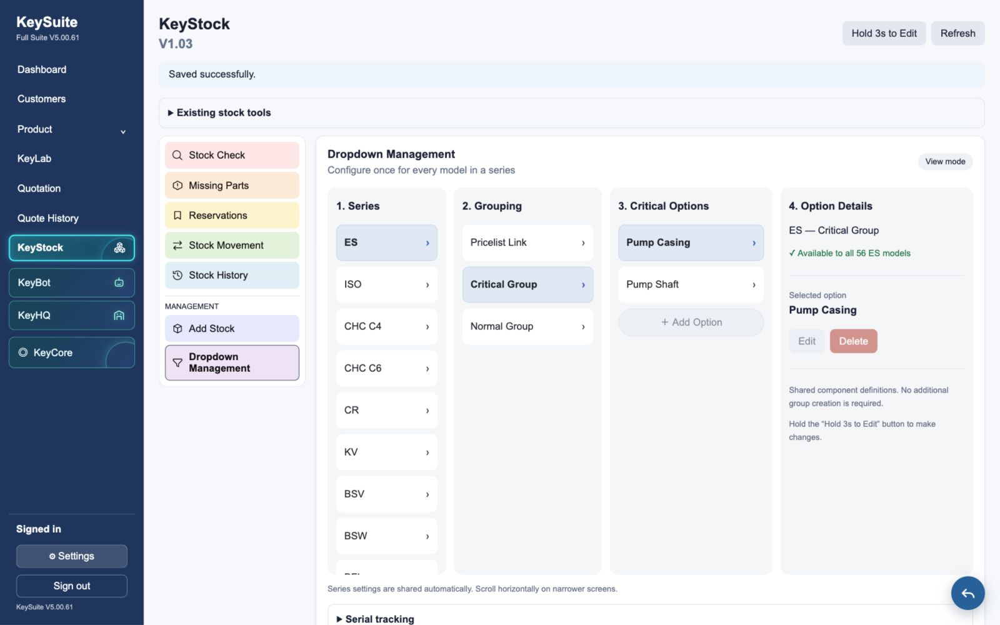
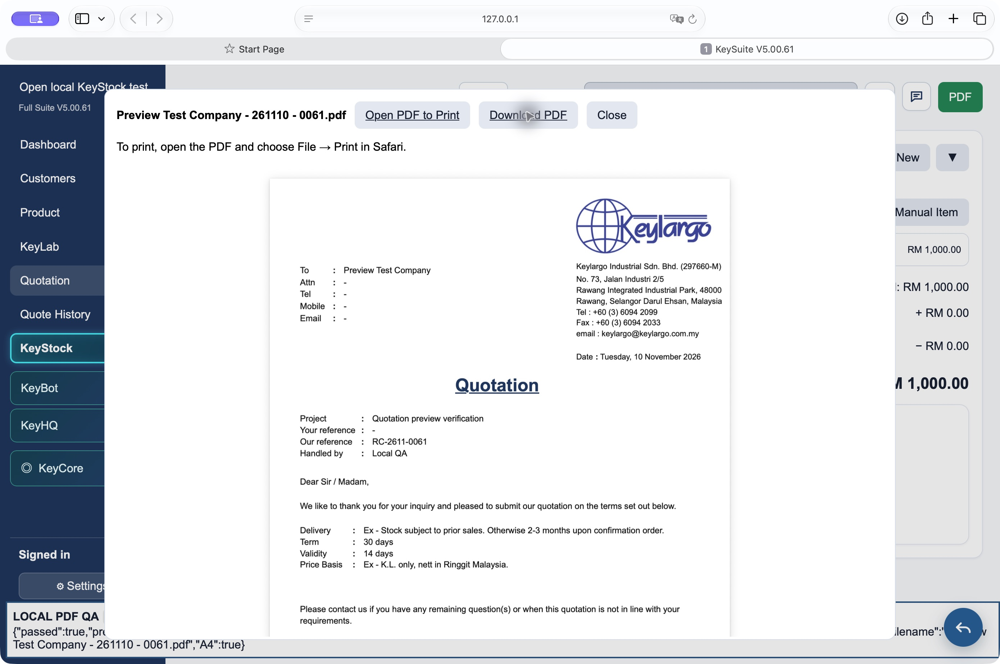

# KeySuite V5.00.61 / KeyStock V1.03 — Checkpoint B review

Development build, reviewed 10 November 2026. **Not deployed. No production database writes were made for Checkpoint B. Checkpoint C has not started.**

## Baseline and scope

The working build uses the supplied V5.00.60 full build. All baseline files are retained. The supplied V5.00.56 build was used specifically to compare and restore its Mac Safari quotation preview implementation. The earlier KeyStock reset report and rollback files are retained separately; this development migration performs no reset.

## Completed interface



- Four columns: Series, Grouping, Options, Option Details.
- Grouping is fixed to Pricelist Link, Critical Group and Normal Group.
- Critical and Normal options can be added, renamed and deleted directly, with no extra group-creation step.
- Options are stored once for a company and series. Existing and future catalogue models inherit them automatically; no per-model copies are created.
- CHC C4 and CHC C6 are separate, using their existing CHC_G1 and CHC_G2 catalogue families.
- Normal options are independent optional selections. Receiving and reconfiguration support multiple applicable Normal options.
- Existing stock menus, serial rules and permissions remain available. Editing requires the existing permission and a three-second hold. Releasing the completed hold leaves editing enabled; Done Editing locks it again.
- At narrow widths, the four columns scroll inside the configuration panel.
- Pricelist Link displays existing catalogue configurations and their applicable models. Exact mapping and arrangement editing remain reserved for Checkpoint C.

The screenshot contains local test options, not production data. Stock Input was not redesigned.

## Quotation preview comparison and restoration

V5.00.60 routes quotation output to browser printing. V5.00.56 includes the Mac Safari PDF generator and preview that are absent from V5.00.60. Those generator and preview functions have been restored verbatim. The V5.00.60 quotation layout builder, print CSS, filename logic, guards and all other app code remain unchanged; only the restoration and one Safari routing line were added to app.js. See `review-v50061/source-comparison.json` for the source comparison.

Both the top Quotation PDF button and the Export Center Quotation PDF button use this route. Mac Safari opens the generated PDF in an in-app PDF viewer, with Open PDF to Print, Download PDF and Close controls. The viewer and download use the same PDF Blob; the preview does not print or repaginate HTML. No 93% scale adjustment is applied. The PDF retains the original V5.00.56 generator's image-based format and A4 page geometry. Product and Selection technical PDF code and the separate KeyHQ history modal are unchanged.



## Test results

| Check | Result |
|---|---|
| Baseline catalogue fixture | 2,587 models retained |
| Series inheritance | Passed ES, ISO, C4, C6 and newly added model cases |
| Option persistence | Add, rename and refresh verified through the interface and local database |
| Validation | Duplicate names, stale edits and wrong-series edits rejected |
| Safe deletion | Unused options retired; options referenced by stock rejected |
| Normal options | Multiple selections, order/deduplication and reconfiguration toggle passed |
| Permissions | Delegated rights, denied rights, company isolation, anonymous denial and private helper access passed |
| Existing ledger regression suite | Passed receiving, FIFO, reservations, partial fulfilment, release, transfer, reconfiguration, return, adjustment, cost, serial and audit checks |
| Editing protection | Short hold stays locked; completed three-second hold unlocks; Done Editing relocks |
| Responsive layout | Four columns at 1600px; at 760px, 838px content scrolls within a 572px panel |
| Migration rollback | Before use, original state restored; after series data exists, rollback refuses without losing data |
| JavaScript / diff checks | Syntax checks and whitespace checks passed |
| V5.00.56 comparison | Restored generator and preview functions match original source exactly |

Native Mac Safari tests used sealed sample quotations and the real app PDF buttons. The local fixture provides sample data and blocks external connections; it is not included by production index.html.

| Sample / entry point | Preview pages | Saved PDF pages | Geometry | Byte comparison |
|---|---:|---:|---|---|
| Single item / top PDF | 2 | 2 | 595 × 842 pt A4 | Identical |
| Eight items / Export Center PDF | 3 | 3 | 595 × 842 pt A4 | Identical |

Every page of the longer PDF was reachable in the viewer. Saved files were separately inspected with pdfinfo, and their SHA-256 hashes match the preview bytes:

- Single: `a35d96ad320c87e825c012db3990f7fbd0cc9367360c56a2f26c79794d687ec4` — 549,504 bytes.
- Multi: `c62e238b5c1fa831813db56b464853f38e398c65802e4fb3fb021b856f2cec12` — 997,051 bytes.

Sample PDFs and screenshots are in `review-v50061/`. The sample filenames there are descriptive review copies; the app supplied `Preview Test Company - 261110 - 0061.pdf` in both cases. Safari adds a suffix when downloading duplicate filenames.

## Proposed database changes

Migration: `supabase/migrations/20261109231350_keystock_v103_series_options.sql`.

| Object | Change |
|---|---|
| `keystock.groups` | Add nullable `series_key`; allow nullable `item_key`; constrain each row to model scope or Critical/Normal series scope; unique company/series/kind index |
| `keystock.options` | Add `revision` default 1 for stale-edit detection |
| `keystock.effective_groups` | New resolver combining model groups and inherited series groups |
| `validate_selections`, `receipt_configuration`, `reconfigured` | New wrappers for independent series Normal options; original implementations retained as private `_v102` functions |
| `keystock.api` | New permission-checked series save/delete actions, audit records, concurrency locking and stale-client protection; other actions delegated to the existing implementation |
| Function access | Private helpers remain unavailable to app users; authenticated users retain access to the existing API entry point |

**Production tables affected: none. Production rows inserted, updated or deleted: zero.** The migration was exercised in local PostgreSQL-compatible PGlite fixtures, not a live Supabase development branch. Live environment acceptance testing remains required after an approved deployment.

On application, the migration seeds no groups/options and deletes no rows. Existing option rows receive revision 1; existing group rows retain their model scope. Later user actions write shared groups, options and audit entries. Catalogue, KeySuite pricelist, quotation/selection/product tables, users and role-permission records are not modified by the migration.

## Rollback and review boundary

`supabase/rollback_keystock_v103_before_use.sql` safely reverses the migration **only before any series definition has been saved**. It deliberately refuses once series data exists. After use, keep V1.03 and correct forward, or prepare a reviewed conversion from a verified backup. Do not deploy the old client over series data: stale clients are intentionally rejected.

Before any approved production application, take and verify a fresh database backup, check deployment prerequisites, and apply the migration and matching client together. No production deployment or Checkpoint C work is authorized by this review package.

## Repeat local checks

From the build folder:

```sh
npm --prefix tests ci
npm --prefix tests run test:series
npm --prefix tests run test:ledger
npm --prefix tests run test:rollback
npm --prefix tests run preview
```

Local KeyStock: `http://127.0.0.1:8304/__safari_fixture.html` → Open local KeyStock test → Dropdown Management.

Local Safari quotation testing: `http://127.0.0.1:8304/__quotation_fixture.html` → Load single-item or multi-item quotation → either quotation-level PDF button. The local server uses a disposable database and never connects to Supabase.
